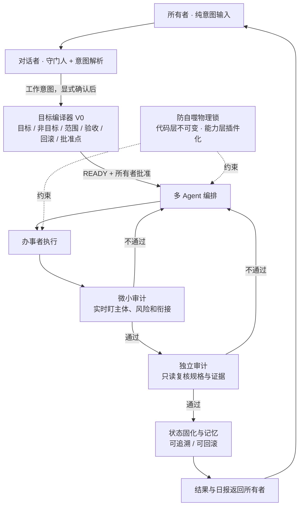

# 完美意图驱动平台 · 闭环架构

> 状态：目标架构 + 当前 PoC 实现进度。
> 本文描述系统要向哪里走，同时明确哪些环节已经落地、哪些仍是 Roadmap，
> 不把未接通的能力冒充完整平台。

## 一句话

所有者只输入意图；系统把意图变成有边界、有证据、可回滚的工作单，
由多 Agent 执行，再经微小审计与独立审计，最后把结果、证据和记忆送回所有者。

## 闭环图

## 四层职责

| 层 | 角色 | 核心职责 | 不能做什么 |
|---|---|---|---|
| 1. 意图入口 | 所有者 + 对话者 | 保留原话；区分闲聊与工作；工作意图必须显式确认 | 闲聊不能偷偷拉工具；对话者不能替所有者拍板 |
| 2. 目标编译 | 目标编译器 V0 | 把显式意图变成目标、非目标、范围、任务、验收、证据、回滚和批准点 | 不猜意图，不执行命令，不授予执行权 |
| 3. 编排执行 | 多 Agent / 办事者 | 按已批准规格执行；失败即停；保留证据 | 不能自批、自验；不能绕过批准点 |
| 4. 审计与固化 | 微小审计 + 独立审计 + 记忆层 | 实时盯偏差；只读复核；通过后固化状态与记忆 | 不能改规格、不能执行、不能替所有者裁决 |

横向约束：

- **防自噬物理锁**：程序不能修改自己的代码；能力扩展通过测试后的插件或技能挂载。
- **人类终裁**：高风险、不可逆、重大承诺和核心方向变更交所有者决策。
- **证据链**：任何“完成 / 通过”都必须有命令、回读或原始输出。

## 当前已落地

- 对话者的“闲聊 / 工作”意图入口与确认闸；
- `work_monitor.py` 的任务级风险预检；
- 目标编译器 V0：确定性规格校验、批准点、红线、回滚和 11 组离线测试；
- 审计者专用只读会话与只读 PowerShell 工具；
- Agent 台账和多 Agent 治理复盘；
- 记忆检索底座与只读查询；
- 项目日报目录、读取清单和自动总结任务。

## 尚未接通

- 对话者 → 目标编译器 → 工作监控的正式接口；
- 多 Agent 编排器对 V0 工作规格的原生读取；
- 审计结论自动回写状态与记忆；
- 记忆档自动晋升（仍必须所有者逐条批准）；
- 电脑关机后的日报补账；
- 手机端远程触达。

## 诚实边界

当前是“治理层 PoC”，不是完整意图驱动平台。

已经证明的是：意图可以被拦住、编译成边界、交给审计；
还没有证明的是：任意复杂意图都能在无人搬运上下文的情况下稳定跑完整条链。

后续每次接入，都必须保留三个看门指标：

1. 规格是否完整；
2. 执行是否越过批准点；
3. 证据能否让独立审计复核。
